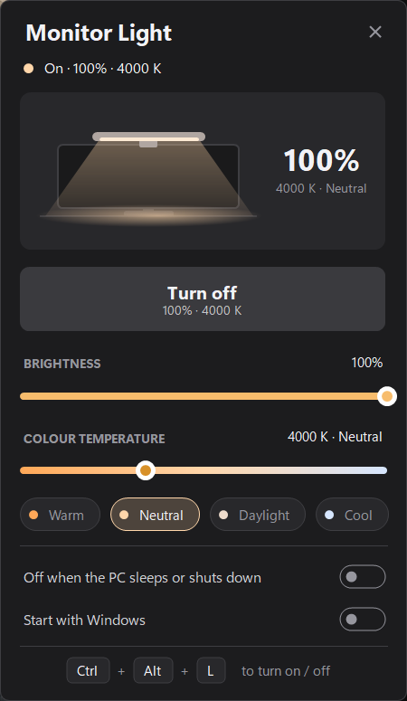

# Monitor Light

Wi-Fi control for a monitor light bar with warm and cool white LEDs. An ESP8266 drives the bar and serves a small HTTP API. A Windows tray app gives you one hotkey for on/off and a panel for brightness and colour temperature.

<p>
  
</p>

## Features

- **Ctrl+Alt+L** turns the light on and off from anywhere
- Brightness from 1 to 100 % and colour temperature from 2700 K (warm) to 6500 K (cool), mixed from the two LED channels
- Dark Windows 11 style tray panel with a live preview of the light, sliders and Warm / Neutral / Daylight / Cool presets
- Tray icon shows the state: amber = on, grey = off, red = not reachable
- Optionally turns the light off when the PC sleeps or shuts down
- Plain HTTP API, so you can also script it with `curl` or `lamp-control.bat`
- No installer and no SDK: the app builds with the C# compiler that ships with Windows

## Repository layout

```
firmware/monitor-light/
  monitor-light.ino      ESP8266 sketch: PWM for the LEDs, HTTP API, mDNS
  secrets.example.h      template for your Wi-Fi name and password
MonitorLight.cs          Windows tray app (single file)
MonitorLight.ico         app icon
build.bat                builds MonitorLight.exe
lamp-control.bat         command-line / menu control
images/                  screenshots
```

## Hardware

| Part | Notes |
|---|---|
| ESP8266 board | Any board that exposes D1 and D2, such as a NodeMCU or Wemos D1 mini |
| ULN2003A | Darlington driver that switches the LED channels on their ground side |
| Monitor light bar | Two white LED channels, warm and cool, with a shared positive line (common anode). Most USB light bars are built this way |
| Power | Usually 5 V USB for the bar; the ESP8266 can run from the same 5 V |

Wiring:

| ESP8266 | ULN2003A | Light bar |
|---|---|---|
| D1 (GPIO5) | IN2 (pin 2) → OUT2 (pin 15) | warm channel − |
| D2 (GPIO4) | IN1 (pin 1) → OUT1 (pin 16) | cool channel − |
| GND | GND (pin 8) | supply GND |
| — | — | common + → supply + |

Each ULN2003A channel handles about 500 mA. If your bar draws more, tie spare channels in parallel (input to input, output to output). Check your bar's wiring with a multimeter first, because not every bar uses a common anode.

The firmware uses 8-bit PWM at 1 kHz. Brightness sets the total output and the colour temperature splits it linearly between the channels: 2700 K is all warm, 6500 K is all cool, and values in between mix the two.

## Firmware

1. Install the [Arduino IDE](https://www.arduino.cc/en/software) and add the ESP8266 core: in **File → Preferences → Additional boards manager URLs** add `https://arduino.esp8266.com/stable/package_esp8266com_index.json`, then install **esp8266** in the Boards Manager.
2. Copy `firmware/monitor-light/secrets.example.h` to `secrets.h` in the same folder and enter your Wi-Fi name and password. `secrets.h` is in `.gitignore`, so it is never committed.
3. Open `firmware/monitor-light/monitor-light.ino`, select your board (for example **NodeMCU 1.0** or **LOLIN(WEMOS) D1 mini**) and upload.
4. Open the Serial Monitor at 115200 baud to see the IP address. The light also answers at `http://desk-lamp.local/` over mDNS (change `HOSTNAME` in the sketch to rename it).

The light keeps trying to reconnect if Wi-Fi drops. It starts switched off at 100 % and 4000 K after a power cycle, because the state is not saved.

## HTTP API

Every response is JSON with the current state: `{"on":true,"brightness":60,"temperature":4000}`.

| Method | Path | Does |
|---|---|---|
| `GET` | `/api/lamp` | returns the state |
| `POST` | `/api/lamp?on=true&brightness=60&temperature=3500` | sets any mix of `on` (`true`/`false`, `1`/`0`, `on`/`off`), `brightness` (1–100) and `temperature` (2700–6500) |
| `POST` | `/api/lamp/on` | turns on |
| `POST` | `/api/lamp/off` | turns off |
| `GET` | `/` | service info |

Invalid values return HTTP 400 with `{"error":"..."}`.

```
curl http://desk-lamp.local/api/lamp
curl -X POST "http://desk-lamp.local/api/lamp?brightness=40&temperature=2700"
curl -X POST http://desk-lamp.local/api/lamp/off
```

## Windows app

### Build

```
build.bat
```

This produces `MonitorLight.exe` using the .NET Framework 4 compiler at `%WINDIR%\Microsoft.NET\Framework64\v4.0.30319\csc.exe`, which ships with Windows. Exit the running app (tray menu → Exit) before rebuilding, because Windows locks the exe while it runs.

### Use

- **Ctrl+Alt+L**: on / off
- **Left-click** the tray icon: open the panel
- **Middle-click** the tray icon: on / off
- **Right-click** the tray icon: Open, Turn on, Turn off, Exit
- Starting `MonitorLight.exe` again while it runs opens the panel

In the panel, drag the sliders or use the mouse wheel or arrow keys over them, at 1 % or 100 K per step. The chips jump to Warm (2700 K), Neutral (4000 K), Daylight (5000 K) or Cool (6500 K). Moving a slider while the light is off turns it on. Esc or clicking elsewhere closes the panel.

### Settings

| Setting | Does |
|---|---|
| Off when the PC sleeps or shuts down | turns the light off just before Windows sleeps or ends the session |
| Start with Windows | adds the exe to `HKCU\Software\Microsoft\Windows\CurrentVersion\Run`, starting in the tray |

Settings are stored in `HKCU\Software\MonitorLight`. Only one copy of the app runs at a time.

### How it works

The app checks the light every 4 seconds, so changes made elsewhere (the script, `curl`, another PC) show up. It looks up the `.local` name once and reuses the IP address, because each mDNS lookup can take a second. The ESP8266 serves one client at a time, so the app sends one request at a time. Slider moves made while a request is in flight are merged into the next one, so dragging never builds up a backlog.

## Command line

`lamp-control.bat` without arguments opens a menu. With arguments:

```
lamp-control.bat on
lamp-control.bat off
lamp-control.bat status
lamp-control.bat brightness 60
lamp-control.bat temperature 4000
```

## Troubleshooting

- **Tray icon is red / "Not reachable":** check that the light has power and is on the same network. If `desk-lamp.local` does not resolve, set the `LAMP_URL` environment variable to the light's IP address (for example `http://192.168.1.50`) and restart the app. `lamp-control.bat` uses the same variable.
- **"Ctrl+Alt+L is used by another app":** another program has registered the hotkey. The tray icon and panel still work.
- **The light flickers on camera:** the PWM runs at 1 kHz. Raise `analogWriteFreq` in the sketch if your camera picks it up.
